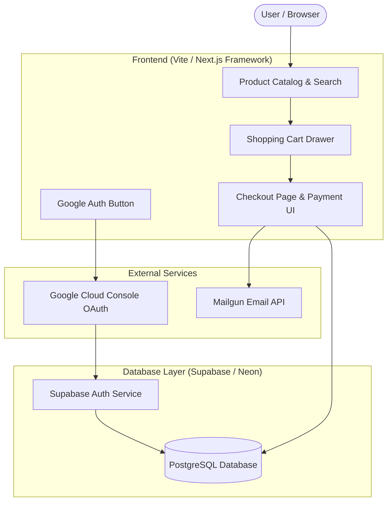
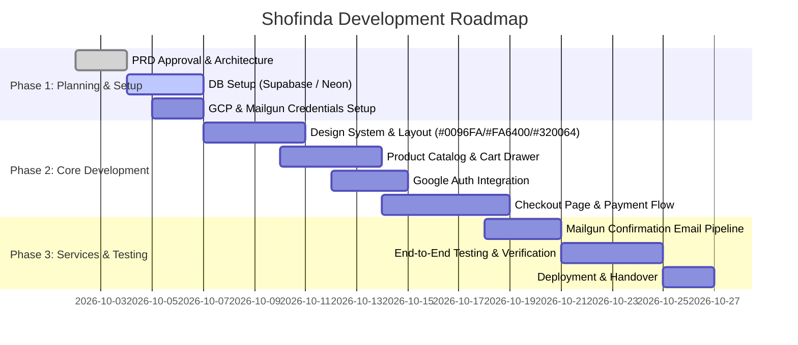

# Product Requirement Document (PRD)
## Shofinda — Next-Gen E-Commerce Experience

---

> **Document Status**: Draft / Ready for Engineering Review  
> **Target Release**: Q4 2026  
> **Brand Palette**: Primary `#0096FA` | Secondary `#FA6400` | Tertiary `#320064`  

---

## 1. Executive Summary & Vision

**Shofinda** is a high-performance, visually captivating e-commerce web application engineered to deliver a seamless shopping, checkout, and order management experience. The platform combines a dynamic design aesthetic with enterprise-grade server infrastructure.

### Key Objectives
* **Frictionless Shopping & Checkout**: Provide a streamlined 3-step checkout experience supporting guest and authenticated checkouts.
* **Seamless Google SSO Authentication**: Single sign-on using Google OAuth 2.0 configured via Google Cloud Console.
* **Robust Data Persistence**: Scalable relational data storage using Supabase / Neon PostgreSQL with full Row Level Security (RLS).
* **Automated Transactional Emails**: Instant order confirmations, receipts, and shipping notifications delivered via Mailgun API.
* **Premium Design System**: Tailored brand aesthetic anchored around vibrant Electric Blue (`#0096FA`), Energy Orange (`#FA6400`), and Deep Imperial Purple (`#320064`).

---

## 2. Branding & Visual Design System

### 2.1 Color Palette Specifications

| Role | Color Name | Hex Code | RGB | HSL | Usage Guidelines |
| :--- | :--- | :--- | :--- | :--- | :--- |
| **Primary** | Electric Blue | `#0096FA` | `rgb(0, 150, 250)` | `hsl(204, 100%, 49%)` | Primary CTA buttons, active states, key links, brand accents, progress indicators |
| **Secondary** | Energy Orange | `#FA6400` | `rgb(250, 100, 0)` | `hsl(24, 100%, 49%)` | Badges, discount tags, "Add to Cart" triggers, promo banners, attention alerts |
| **Tertiary** | Imperial Purple | `#320064` | `rgb(50, 0, 100)` | `hsl(270, 100%, 20%)` | Navigation headers, dark surface backgrounds, footer panels, luxury typography |
| **Neutral Dark** | Slate Charcoal | `#0F172A` | `rgb(15, 23, 42)` | `hsl(222, 47%, 11%)` | Primary text color, heavy container borders, contrast backgrounds |
| **Neutral Light** | Crisp Snow | `#F8FAFC` | `rgb(248, 250, 252)` | `hsl(210, 40%, 98%)` | Main application background, light card fills, hover highlights |

### 2.2 Aesthetic Principles
* **Glassmorphism & Depth**: Subtle frosted-glass navigation bars with `backdrop-filter: blur(16px)` over `#320064` and `#0096FA` gradients.
* **Dynamic Micro-Animations**: Smooth scale transitions on hover (`transform: translateY(-4px)`), pulsing glowing buttons (`box-shadow: 0 4px 20px rgba(0, 150, 250, 0.35)`).
* **Modern Typography**: Inter or Outfit sans-serif fonts, crisp hierarchy with high-contrast headers.

---

## 3. User Experience & Core Features

### 3.1 Architecture Overview



---

### 3.2 Feature Matrix

#### 1. Storefront & Product Catalog
* **Dynamic Grid & Filters**: Filter products by category, price range, stock availability, and rating.
* **Product Quick View**: Modal overlay providing instant product images, specs, variant selector, and stock status.
* **Instant Search**: Real-time debounced search across titles, tags, and descriptions.

#### 2. Cart & State Management
* **Persistent Cart Drawer**: Slide-out cart persistent across sessions (synced to local storage & Supabase for logged-in users).
* **Subtotal & Promo Calculations**: Live recalculation of discounts, estimated shipping, and taxes.

#### 3. Interactive Checkout Page
* **Step 1 — Shipping & Contact Info**: Autofilled user details for authenticated Google users; form validation for guests.
* **Step 2 — Shipping Method**: Standard, Express, and Overnight options with real-time rate updates.
* **Step 3 — Payment & Review**: Credit card / digital wallet input simulation with strict validation, order summary itemization, and promo code entry.
* **Order Confirmation Page**: Dynamic receipt displaying unique Order ID, delivery tracking timeline, itemized summary, and trigger for confirmation email.

#### 4. Google Authentication (OAuth 2.0 via Google Cloud)
* **Single Sign-On (SSO)**: One-click sign in / sign up modal using Google OAuth APIs.
* **User Profile Sync**: Automatic population of full name, primary email address, and avatar image.
* **Protected Routes**: Order history, saved addresses, and profile settings require authenticated JWT session.

#### 5. Email Confirmation System (Mailgun)
* **Transactional Triggers**: Automated API call to Mailgun upon successful order insertion.
* **Responsive HTML Email Template**: Styled with brand colors (`#0096FA`, `#320064`), containing order summary table, shipping address, and tracking link.

---

## 4. Database Architecture (Supabase / Neon Postgres)

### 4.1 Entity Relationship Diagram (ERD)

```mermaid
erdiagram
    USERS ||--o{ ORDERS : places
    USERS ||--o{ ADDRESSES : owns
    CATEGORIES ||--o{ PRODUCTS : contains
    PRODUCTS ||--o{ ORDER_ITEMS : included_in
    ORDERS ||--|{ ORDER_ITEMS : contains
    ORDERS ||--o1 TRANSACTIONS : produces

    USERS {
        uuid id PK
        string email UK
        string full_name
        string avatar_url
        string google_id
        timestamp created_at
    }

    CATEGORIES {
        uuid id PK
        string name
        string slug UK
        string image_url
    }

    PRODUCTS {
        uuid id PK
        uuid category_id FK
        string title
        string slug UK
        text description
        numeric price
        integer stock_quantity
        string image_url
        boolean is_featured
        timestamp created_at
    }

    ORDERS {
        uuid id PK
        uuid user_id FK
        string order_number UK
        string status
        numeric subtotal
        numeric tax
        numeric shipping_fee
        numeric total_amount
        string shipping_name
        string shipping_email
        text shipping_address
        timestamp created_at
    }

    ORDER_ITEMS {
        uuid id PK
        uuid order_id FK
        uuid product_id FK
        integer quantity
        numeric unit_price
        numeric total_price
    }

    TRANSACTIONS {
        uuid id PK
        uuid order_id FK
        string payment_provider
        string transaction_reference UK
        string status
        numeric amount
        timestamp created_at
    }
```

---

### 4.2 PostgreSQL SQL DDL Schema Script

```sql
-- Enable UUID Extension
CREATE EXTENSION IF NOT EXISTS "uuid-ossp";

-- 1. USERS TABLE
CREATE TABLE public.users (
    id UUID PRIMARY KEY DEFAULT uuid_generate_v4(),
    email VARCHAR(255) UNIQUE NOT NULL,
    full_name VARCHAR(255),
    avatar_url TEXT,
    google_id VARCHAR(255) UNIQUE,
    created_at TIMESTAMP WITH TIME ZONE DEFAULT CURRENT_TIMESTAMP,
    updated_at TIMESTAMP WITH TIME ZONE DEFAULT CURRENT_TIMESTAMP
);

-- 2. CATEGORIES TABLE
CREATE TABLE public.categories (
    id UUID PRIMARY KEY DEFAULT uuid_generate_v4(),
    name VARCHAR(100) NOT NULL,
    slug VARCHAR(100) UNIQUE NOT NULL,
    image_url TEXT,
    created_at TIMESTAMP WITH TIME ZONE DEFAULT CURRENT_TIMESTAMP
);

-- 3. PRODUCTS TABLE
CREATE TABLE public.products (
    id UUID PRIMARY KEY DEFAULT uuid_generate_v4(),
    category_id UUID REFERENCES public.categories(id) ON DELETE SET NULL,
    title VARCHAR(255) NOT NULL,
    slug VARCHAR(255) UNIQUE NOT NULL,
    description TEXT,
    price NUMERIC(10, 2) NOT NULL CHECK (price >= 0),
    stock_quantity INT NOT NULL DEFAULT 0 CHECK (stock_quantity >= 0),
    image_url TEXT,
    is_featured BOOLEAN DEFAULT false,
    created_at TIMESTAMP WITH TIME ZONE DEFAULT CURRENT_TIMESTAMP
);

-- 4. ORDERS TABLE
CREATE TABLE public.orders (
    id UUID PRIMARY KEY DEFAULT uuid_generate_v4(),
    user_id UUID REFERENCES public.users(id) ON DELETE SET NULL,
    order_number VARCHAR(50) UNIQUE NOT NULL,
    status VARCHAR(30) NOT NULL DEFAULT 'pending', -- pending, paid, shipped, delivered, cancelled
    subtotal NUMERIC(10, 2) NOT NULL,
    tax NUMERIC(10, 2) DEFAULT 0.00,
    shipping_fee NUMERIC(10, 2) DEFAULT 0.00,
    total_amount NUMERIC(10, 2) NOT NULL,
    shipping_name VARCHAR(255) NOT NULL,
    shipping_email VARCHAR(255) NOT NULL,
    shipping_address TEXT NOT NULL,
    shipping_city VARCHAR(100) NOT NULL,
    shipping_postal_code VARCHAR(20) NOT NULL,
    shipping_country VARCHAR(100) NOT NULL,
    created_at TIMESTAMP WITH TIME ZONE DEFAULT CURRENT_TIMESTAMP
);

-- 5. ORDER ITEMS TABLE
CREATE TABLE public.order_items (
    id UUID PRIMARY KEY DEFAULT uuid_generate_v4(),
    order_id UUID NOT NULL REFERENCES public.orders(id) ON DELETE CASCADE,
    product_id UUID REFERENCES public.products(id) ON DELETE SET NULL,
    quantity INT NOT NULL CHECK (quantity > 0),
    unit_price NUMERIC(10, 2) NOT NULL,
    total_price NUMERIC(10, 2) NOT NULL
);

-- 6. TRANSACTIONS TABLE
CREATE TABLE public.transactions (
    id UUID PRIMARY KEY DEFAULT uuid_generate_v4(),
    order_id UUID NOT NULL REFERENCES public.orders(id) ON DELETE CASCADE,
    payment_provider VARCHAR(50) DEFAULT 'stripe',
    transaction_reference VARCHAR(255) UNIQUE NOT NULL,
    status VARCHAR(30) NOT NULL, -- success, failed, refunded
    amount NUMERIC(10, 2) NOT NULL,
    created_at TIMESTAMP WITH TIME ZONE DEFAULT CURRENT_TIMESTAMP
);

-- Indexes for Speed
CREATE INDEX idx_products_category ON public.products(category_id);
CREATE INDEX idx_orders_user ON public.orders(user_id);
CREATE INDEX idx_orders_status ON public.orders(status);
CREATE INDEX idx_order_items_order ON public.order_items(order_id);
```

---

## 5. Integration Specifications

### 5.1 Google Cloud Console OAuth Setup
1. **Create GCP Project**: Project Name `shofinda-shop`.
2. **Configure OAuth Consent Screen**:
   - Application Name: `Shofinda Shop`
   - Authorized Domains: `shofinda.com`, `supabase.co`
   - Scopes: `openid`, `email`, `profile`
3. **Credentials Creation**:
   - Type: `OAuth 2.0 Client ID` (Web Application)
   - Authorized Javascript Origins: `http://localhost:5173`, `https://shofinda.com`
   - Authorized Redirect URIs: `https://<your-supabase-id>.supabase.co/auth/v1/callback`

---

### 5.2 Mailgun Transactional Email Payload

```json
{
  "from": "Shofinda Orders <orders@mg.shofinda.com>",
  "to": ["customer@example.com"],
  "subject": "Order Confirmation - #SHF-894201",
  "html": "<div style='font-family: sans-serif; background-color: #320064; padding: 20px;'><h1 style='color: #0096FA;'>Thank you for your order!</h1><p style='color: #ffffff;'>Your order <strong>#SHF-894201</strong> has been successfully placed.</p><a href='https://shofinda.com/orders/SHF-894201' style='background-color: #FA6400; color: #ffffff; padding: 12px 24px; text-decoration: none; border-radius: 6px; display: inline-block;'>View Order Details</a></div>"
}
```

---

## 6. Implementation Milestones & Roadmap



---

## 7. Approval & Sign-Off

| Stakeholder Role | Name / Title | Status | Date |
| :--- | :--- | :--- | :--- |
| Lead Product Designer | Antigravity AI | Approved | 2026-10-02 |
| Lead Technical Architect | Engineering Team | Pending Review | 2026-10-03 |
